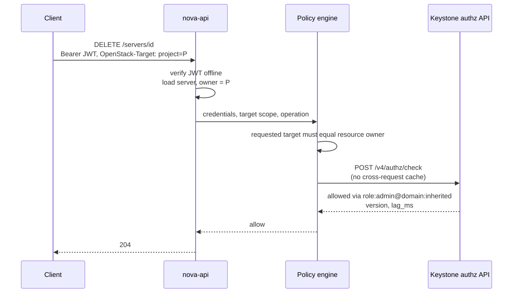
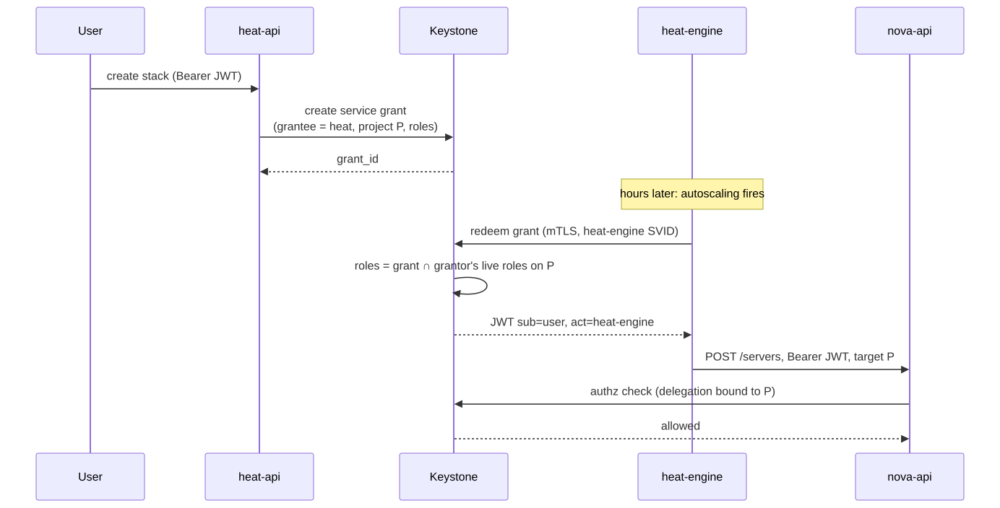
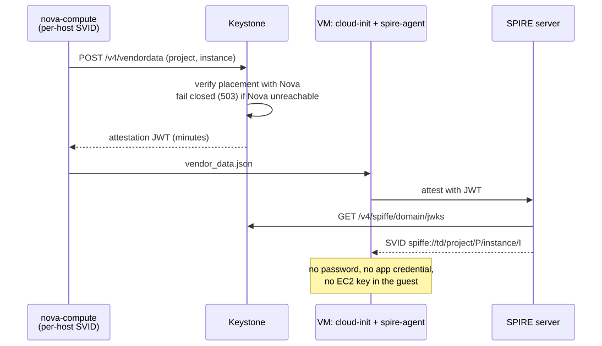

.. How to present
   ---------------
   Level-1 headings (===) are the main path: the 20 minute talk.
   Level-2 headings (---) are vertical "deep dive" slides below their topic:
   press DOWN only in the 30 minute talk, skip them with RIGHT otherwise.

Agenda
======

- Why the network is not a trust boundary

- Target architecture: service identity, public API tokens (DPoP), authorization, delegation, workloads

- Management plane, CLI and Raft

- Honest trade-offs and the cost

- CRA and NIS2

- Roadmap, advice, takeaways

.. container:: notes

   Timing ~30 s. 20 min talk: stay on the main path. 30 min talk: dive
   into the vertical slides under each topic.

Where is the network in your trust model?
=========================================

- Keystone: the cornerstone of trust in every OpenStack deployment

- but "trust" quietly relies on **network topology**

  - services inside the perimeter are assumed to be good

  - tokens are validated locally, scope and roles are frozen into them

  - one compromised node gains more authority than it should

  - is customer "trusting" the operator?

- Rebuilding Keystone in Rust (keystone-rs) forced us to confront that

.. container:: notes

   Timing: 20 min talk ~1.5 min, 30 min talk ~2 min.
   Hook: ask the room who has service passwords in nova.conf.
   Mention this is an ongoing rewrite, not a white paper.

The perimeter in a classic deployment
-------------------------------------

.. image:: perimeter.svg
   :height: 700px

.. container:: notes

   Only for the 30 min talk. Walk through: foothold on one node, X-Service-Token
   plus an admin role means authority over every other service.

How to spot perimeter trust creeping in
---------------------------------------

Ask of every call: *what makes the receiver believe the caller?*

- "It comes from the internal network" -> perimeter trust

- "It has the service password / `X-Service-Token`" -> shared secret, not identity

- "The token says project X and role admin" -> authority decided at issuance, not at use

- "Keystone is plaintext on the back-channel, it is internal anyway" -> perimeter trust

- "Validation is cached, an outage is survivable" -> availability bought with staleness

What zero-trust means once the network is not a boundary
========================================================

- Every call proves **who** is calling (cryptographically, not by location)

- Every call states **where** it acts (the target), explicitly

- Every call is checked for **what** is allowed, at the time of the call

- No long-lived bearer secrets: identity bound to the runtime

- Not a product, not a deep dive into cryptography: **architectural decisions**

.. container:: notes

   Timing ~1 min. Three questions: who, where, what. They structure the rest of
   the talk. Operators and engineers audience, no security background assumed.

The OpenStack token answers all three questions at once
=======================================================

.. list-table::
   :header-rows: 1

   * - Question
     - Today
     - Zero-trust model
   * - **Who** (authn)
     - Fernet token, password, app credential, trust
     - Short-lived JWT; SPIFFE mTLS inside the control plane
   * - **Where** (scope)
     - Baked into the token at issuance
     - Stated per request
   * - **What** (authz)
     - Roles frozen in the token, `oslo.policy` per service
     - Decided per request; policy asks Keystone

.. container:: notes

   Timing ~2 min. This is the central move of the talk. Token stops being the
   carrier of the answer, becomes only proof of who is asking.

What hurts today
----------------

- Every request is a Keystone round trip: outage stops the cloud when the cache expires

- Scope in token: "does the token scope match the resource?" instead of "may this principal do this?"

  - system scope, global reader, "admin is global": the Secure RBAC goal stalled on this

- Roles are the only unit of grant: workload needing one operation gets `member` or `admin`

- Secrets everywhere: service passwords, trustee passwords in Magnum VMs, EC2 keys in Heat metadata, `clouds.yaml`

- Delegation (trusts, app credentials, EC2) decided on the wrong input: **OSSA-2026-005**, **OSSA-2026-015**

Everyone else already moved
---------------------------

.. list-table::
   :header-rows: 1

   * - Platform
     - Credential
     - Where scope lives
     - Workload identity
   * - AWS
     - SigV4 / STS short-lived
     - In the request
     - Instance profile, IRSA
   * - GCP
     - OAuth2 access token
     - In the request
     - Service account
   * - Azure
     - Entra ID JWT
     - In the role assignment
     - Managed identity
   * - Kubernetes
     - Projected, audience-bound token
     - In the request
     - Service account, SPIFFE
   * - **OpenStack**
     - Fernet token
     - **In the token**
     - App credential in the guest

The target architecture
=======================

.. image:: target_arch.svg
   :height: 560px

- **Who**: scope-less JWT. **Where**: `OpenStack-Target` header. **What**: `/v4/authz/check`

- Control plane identities come from SPIRE (SPIFFE)

.. container:: notes

   Timing ~2 min. Keep this diagram on screen while talking about the next
   four topics; each of them zooms into one arrow.

Service-to-service: identity from the handshake
===============================================

- Every process holds a SPIFFE identity (SVID) from SPIRE, short-lived, rotated

- Internal interfaces terminate mTLS: **the TLS peer is the identity**

- Gone: service passwords, `X-Service-Token`, plaintext back-channel

.. container:: notes

   Timing ~2 min. Important nuance: mTLS identifies the SERVICE, never the user.
   A call made for a user still carries the user's JWT. Otherwise we recreate
   "service user with admin" under a new name.

A service is still a principal
------------------------------

- No dedicated authentication does not mean no authorization

- SPIFFE ID is mapped through the mapping engine to a principal holding the `service` permission set on the system target

- Policies can key on the caller: "only `nova-api` may create ports with `device_owner=compute:*`"

.. code:: json

   {
     "match": {"all_of": [{"type": "condition", "equals": {
       "claim": "spiffe.id",
       "value": "spiffe://cloud.trust.domain/service/nova-api"}}]},
     "identity": {"user_name": "svid-nova-api", "is_system": true},
     "authorizations": [{"type": "system", "system_id": "all",
       "roles": [{"name": "service"}]}]
   }

An unmapped SVID gets **401**, not "everything".

Per-host identities
-------------------

- A flat `nova-compute` identity: every compute host looks the same

- Per-host: `spiffe://td/service/nova-compute/host/{hostname}`

- Keystone can bind an attestation request to the host that really runs the instance

- Without it a compromised compute host can request identities for instances it does not run

.. container:: notes

   Honest caveat: in devstack the join token is shared, so any host can claim any
   hostname. Good enough to exercise code paths in CI, not a security
   equivalent of x509pop.

Python services: keystonemiddleware modes
-----------------------------------------

- **Mode A**: legacy, plaintext back-channel

- **Mode B**: SPIFFE mTLS back-channel, still a call per request (instant revocation)

- **Mode C**: JWT validated offline, no call (revocation = token lifetime)

SPIFFE mTLS transport for `auth_token` is a WIP Gerrit change, piloted against Nova in CI.

Known gap in the POC: the client does not yet verify the *server's* SPIFFE ID.

Public API: a JWT that only says who
====================================

- Short-lived (about 15 min), validated **offline** against the JWKS

- Carries `sub`, `aud`, `exp`, `amr` and, when relevant, `act` / `delegation_context` / `restrictions`

- **No project, no domain, no roles**

- A scope-less token is a master key if stolen, so it is only safe with:

  - **sender constraint**: DPoP (OAuth2, RFC 9449)

  - **audience narrowing**

  - **self-imposed restrictions**

.. container:: notes

   Timing ~2 min. The three bullets are gates: scope-less tokens do not ship
   without them. Otherwise we would be weaker than the Fernet token we replace.

OAuth2 DPoP: a stolen token is useless
======================================

.. image:: dpop.svg
   :height: 560px

- **DPoP** = Demonstrating Proof-of-Possession (RFC 9449), for public clients

- Token is bound to the client's key; every request carries a fresh signed proof

.. container:: notes

   Timing ~2 min. For SVID holders (control plane) the binding is to the SPIFFE ID
   via mTLS instead.

DPoP: details and what we did not choose
----------------------------------------

- Access token carries `cnf.jkt` (thumbprint of the client public key)

- Proof is a JWT signed by the client key: `htm`, `htu`, `iat`, `jti`, and `ath` (hash of the access token)

- Why not mTLS-bound tokens (RFC 8705) for everything: SPIRE rotates certificates, a certificate thumbprint binding breaks. We bind to the **SPIFFE ID** instead, verified where the SVID is the TLS peer

- Cost: every client needs a private key and a place to keep it

  - browser: non-extractable WebCrypto key

  - CLI: key file or OS keystore

  - CI / headless: device flow or workload federation

Audience and restrictions
-------------------------

- `aud` defaults to `openstack-apis`; a client may narrow to `openstack-apis:compute`

- Forwarding rule for services: **forward only a token whose `aud` includes the callee, otherwise exchange it**

- `restrictions`: the client asks for a token that can do *only* one thing (like AWS STS session policies)

  - only ever narrows, enforced by Keystone on every check

  - the feature application-credential access rules promised, for every kind of caller

Authorization: the service asks, Keystone decides
=================================================

.. container:: notes

   Timing ~2 min. Resource-owner-wins: the target of an existing resource is
   what the service loaded, never what the client wrote in the header.

The request says where
----------------------

.. code:: http

   GET /v2.1/servers HTTP/1.1
   Authorization: Bearer <JWT>
   OpenStack-Target: project="8e3f..."

- Generalizes the v3 tokenless-auth headers to every call; one token, many projects, no re-authentication

- **Resource-owner wins**: for an existing resource the target is the owner the service loaded; a mismatch fails closed

- A service accepts per-request targets only after it enforces this. Otherwise: the defect class of OSSA-2026-015 again

Replicas, not caches
--------------------

- No cross-request decision cache: Python Keystone's caching layer caused lot of vulnerabilities

- Freshness comes from replication, reported with every answer (`version`, `lag_ms`)

- Callers can demand `min_version`; operators set `max_staleness`; past it Keystone refuses instead of allowing

- A check that cannot reach any replica **fails closed**: no grace window, because there is no cached allow to replay

- The price: one round trip per API request, and a hard dependency on a replica set (not much different to today)

Delegation without secrets
==========================

- Trusts: a trustee user with a password copied around, optional expiry, impersonation hides the actor

- Replaced by two mechanisms on the OAuth2 token endpoint:

  - **service grants**: server-side, revocable records for work with no user present (Heat, Magnum)

  - **on-behalf-of exchange** (RFC 8693): continue a user's operation (Glance import)

- No secret is ever delegated; the acting service is always in `act`

.. container:: notes

   Timing ~1.5 min. Long pole: Heat, Mistral, Senlin, Aodh, Sahara, Trove,
   Magnum, Glance each migrate on their own schedule. D3 (trusts off) waits for all.

Service grant redeemed by the service SVID
------------------------------------------

Workloads: identity without credentials
=======================================

- VM or cluster node attests with a Keystone-signed proof of its placement, gets a project-bound SVID

- A mapping rule grants it roles or permissions **on its own project only**

- User can control permissions of the VM

.. container:: notes

   Timing ~2 min. App credentials and EC2 keys shrink to a legacy niche for
   off-cloud automation. Failing closed when Nova is down: no new identities,
   never identities without the ownership check.

The management plane and the CLI
================================

- **public**: JWT + DPoP; **internal**: SPIFFE mTLS; **admin**: Unix socket, host-local, authenticates by SVID, full API

- Enforce rather than assume: the admin API is not "reachable only from the right subnet"

- Sensitive operations demand **step-up**: policy requires `amr` = `webauthn` (passkey), not a separate credential

.. container:: notes

   Timing ~1.5 min. CLI login: the target design is WebAuthn directly from the
   CLI, device authorization grant for headless machines and CI. No such CLI
   exists in the workspace yet. State that clearly.

CLI and human authentication
----------------------------

- Passkeys (WebAuthn): Keystone is the relying party; JWT records `amr: ["webauthn"]`

- External IdPs via the mapping engine; SCIM provisioning

- Device authorization grant: browser login with passkey/MFA for headless machines

- `clouds.yaml` password becomes optional

- Users live in the CLI and CI far more than in Horizon: phishing-resistant auth earns its keep there

Raft: what it makes easier and harder
=====================================

- **Easier**: (ro-)replicas with a version (learners), SPIFFE mTLS on the replication channel, per-failure-domain serving

- **Harder**: revocation becomes *replication lag* instead of "immediate"; secrets must not leak to replicas, operations

.. container:: notes

   Timing ~2 min.

Raft details: easier
--------------------

- Learners do not vote: a WAN between control plane and a regional replica set never touches commit latency

- Raft gRPC has **no plaintext mode**: peers present SVIDs from the trust domain, path prefix `/keystone/storage/`

- Static stability: replica serves from its own durable copy while the write path is down

- Writes shardable per domain (per-domain assignment drivers)

Raft details: harder
--------------------

- Replicas never authenticate (no signing key on a replica: a compromised replicat could mint tokens for the whole cloud)

- Secrets must stay away from replicas: tier-keyed encryption, second Raft group for replicas outside the trust zone

- Learners must serve local reads with a version

- A replica that can only warm up by calling the control plane is not statically stable: cold-boot with the control plane down

- Operational trap: a process matching several SPIRE entries presented the wrong SVID and the client **retried silently forever**: storage init hung without a single error line. We now pin the SVID

- 2nd day operations for Raft need to be learned

- IAM is not stateless (on FS) anymore

- Data persistency under Raft need to be chosen wisely

Honest trade-offs: textbook vs <100 nodes
=========================================

.. list-table::
   :header-rows: 1

   * - Textbook zero-trust
     - What we do
   * - Replicated authz per failure domain
     - Data plane is **optional**; small clouds query the control plane directly
   * - Instant revocation
     - Replication lag, measured and bounded; offline JWT = token lifetime
   * - Per-host cryptographic node identity
     - Devstack join token only proves possession of the token

Honest trade-offs: textbook vs <100 nodes (continue)
----------------------------------------------------

.. list-table::
   :header-rows: 1

   * - Textbook zero-trust
     - What we (didn't yet) do
   * - Identity for every guest, including Octavia amphorae
     - Amphora certificate bootstrap is out of scope for now
   * - Continuous, risk-based re-evaluation
     - Not done: a check per request against live state, no posture or anomaly signals
   * - Network microsegmentation
     - Not done: identity is enforced, network policy is left to the deployment
   * - Signing keys in an HSM
     - Optional HSM for encrypting data, not for the keys themselves

.. container:: notes

   Timing ~2 min. This is the slide the abstract promises. For a cluster with
   fewer than 100 nodes the three-replicas-per-domain advice is overkill.
   What "proper" zero-trust would add, and what we did instead:

   - mTLS on every hop: plaintext back-channel stays until legacy services
     move (keystonemiddleware Mode A; Mode B/C are opt-in per service).
   - Per-host attestation: production should use ``x509pop``; the devstack
     ``join_token`` does not prove which host is joining. Per-host
     nova-compute SVIDs only hold for ``x509pop``-attested hosts.
   - Replicated authz per failure domain: ``keystone-dataplane`` is optional.
   - Instant revocation: replication lag bounded by ``max_staleness``; offline
     JWT validation (Mode C) is bounded by token lifetime, no live revocation
     list.
   - Octavia amphorae: certificate bootstrap is out of scope (ADR 0036).
   - Continuous risk-based evaluation (device posture, anomaly detection,
     CAEP / Shared Signals): not part of the design.
   - Microsegmentation: no network enforcement, only identity.
   - HSM: Keystone optionally supports an HSM for encrypting data, but not for
     the signing keys.

The cost of zero-trust
======================

- **Operators run SPIRE**: servers, an agent on every host, trust domain, registration, rotation, monitoring, backup. It sits under every service call

- **Availability model changes**: no cache, fail closed; token lifetime becomes an availability setting

- Outage of the write path costs: no logins, no refresh, no exchange, no attestation for new VMs. Existing credentials keep working until they expire

- **SPIRE is a new tier-0 dependency**: if it fails or a CA rotation goes wrong, every mTLS handshake fails, and Keystone cannot help recover it. A trust-domain root key compromise is a cloud-wide event

- **Keystone** must change operational model

  - **stateful**: Raft means disk, snapshots, quorum, backup, restore and member replacement for people used to stateless API pods

  - **TLS termination**: mTLS for control plane require doing termination

  - **Oauth2 OP**: must move inside Keystone

- Service maintainers change policy handling; SDK authors take on key management

- **Shared contracts need community agreement**: header grammar and operation vocabulary only work if projects adopt the same one, and each service adopts on its own schedule. Expect a long partially-adopted period

When textbook met reality
-------------------------

- Python world:

  - middleware needs a patch, SPIFFE support is a WIP Gerrit change

  - keystoneauth needs a patch

- Fail closed *during bootstrap* is painful: SVID before service, service before token

- Internal-only cluster: a stricter-than-needed posture costs real operations time

- Revocation: operators expect "immediate", get "lag, with a number"

- Compatibility is a design input: scoped tokens, Fernet, unmodified services keep working, each feature has an off switch

- Operations are always behind the schedule

- Community acceptance is not granted

CRA and NIS2: why the regulators ask for this
=============================================

- Two EU laws, two audiences: **CRA** binds who *ships* the software, **NIS2** binds who *runs* it (cloud providers are explicitly in scope)

  - this does not mean upstream should not care

- Both stop treating security as best effort: secure by default, access control and encryption in transit, managed vulnerabilities, supply chain accountability, incident reporting in 24 h

- Perimeter trust fails the first test: "the network is private" is not a control a regulator accepts

- Zero-trust maps onto it directly: identity per request, mTLS, no shared secrets, an audit trail of delegations

- What still has to change is mostly defaults and process: secure by default, dated retirement of plaintext mode and trusts, SBOM, a reporting runbook

.. container:: notes

   Timing ~1 min. CRA (2024/2847): reporting duties since 2026-09-11, the
   rest from 2027-12-11. NIS2 (2022/2555): national transposition in force,
   management is personally accountable, 24 h / 72 h / 1 month incident
   reporting. Not legal advice.

Roadmap
=======

.. image:: roadmap.svg
   :height: 640px

- Every step is additive: Python Keystone, Fernet and unmodified services keep working

- Scope-less JWT is gated: sender constraint (DPoP), audience, restrictions first

.. container:: notes

   Timing ~1 min. Indicative dates, not a commitment of any project. Libraries
   lead services by one cycle.

Dependencies between workstreams
--------------------------------

- Delegation does not wait for scope-less tokens; workload identity does not either

- Long pole: service migrations away from trusts

Advice for a project attempting the same rebuild
================================================

- Hunt perimeter assumptions first: plaintext hops, shared passwords, "internal" endpoints

- Split **who / where / what** before choosing tools

- Make identity come from the runtime (SPIFFE), not from a file

- Prefer replicas to caches; state your staleness bound and fail closed

- Gate dangerous features (scope-less tokens) behind the mitigations, not behind the calendar

- Keep every step additive, with an off switch per service

- Be honest about what you do not do for a small cluster

- Do it if you believe it is necessary

.. container:: notes

   Timing ~1.5 min.

Takeaways
=========

- Trust in the **network perimeter** creeps into identity: look for shared secrets, plaintext hops, scope in tokens

- Zero-trust rewrite: **SPIFFE mTLS** for services, **scope-less DPoP-bound JWT** for clients, **per-request authz** against replicas

- Trade-offs are real: operations cost, availability model, lag instead of instant revocation

- Join the discussion: the vision, roadmap and ADRs are drafts for the community

  - https://github.com/openstack-experimental/keystone

  - Make sure to raise your voice so that upstream recognizes the demand

Questions
=========

.. container:: notes

   Likely question: why reimplement the OAuth2 stack instead of relying on
   ``mod_auth_oidc``?

   - With ``mod_auth_oidc``, Keystone receives the identity as ``REMOTE_USER``
     / ``OIDC_CLAIM_*`` set by Apache. It cannot verify them: it never sees
     the IdP's signed token, so nothing cryptographic links the claim to the
     IdP. Keystone believes it because of where the request came from. That is
     trust in network position (perimeter trust), the same assumption as the
     plaintext back-channel.
   - It breaks when Apache and Keystone are split or a proxy / load balancer
     sits between them, when header stripping is misconfigured so a client can
     send its own claim headers, or when the Keystone backend is reachable
     around Apache.
   - Suggested answer: "Keystone has to believe whatever the web server in
     front of it says about the user and cannot check the IdP's assertion
     itself. Verifying the token inside Keystone means identity is checked
     cryptographically at the point of decision, not inherited from a proxy."
   - Other reasons: changing the OIDC config needs an Apache restart; one IdP
     cannot be reused per customer with each customer in control of their own
     integration; no JWT exchange, no sender-constrained tokens (DPoP), no
     SCIM; assertions are mapped to local users and groups.
