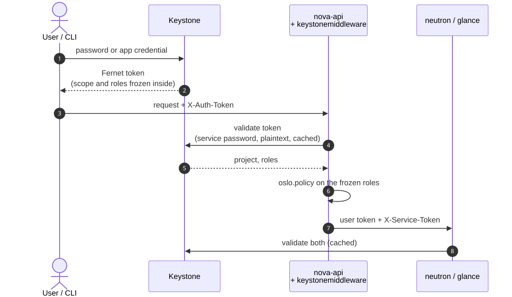
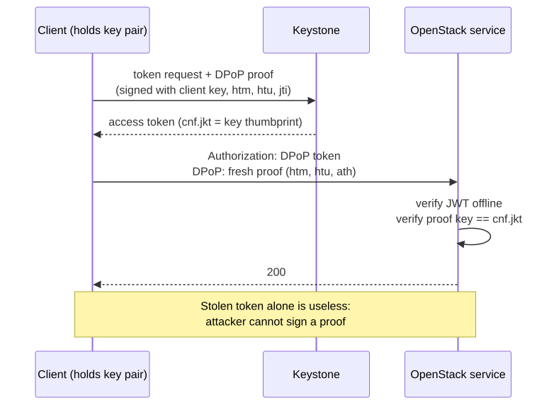
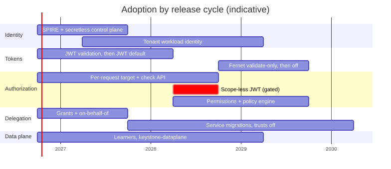

.. How to present
   ---------------
   Short, high-level version of zero_trust.rst (about 20 minutes, no
   vertical slides). Flow: requirements -> where we are -> how we get there
   -> lessons.

Agenda
======

- **Requirements**: what security and the law ask of us

- **Where we are**: how authn/authz works in OpenStack today

- **How we get there**: the target design and the roadmap

- **Lessons learned**: what it costs and what we would do again

.. container:: notes

   Timing ~30 s.

What are we protecting? Three questions on every call
=====================================================

- **Who** is calling?

- **Where** (which project, domain, system) does the call act?

- **What** is this caller allowed to do there, *now*?

- Today one object answers all three: the **Fernet token**

- Zero-trust here means: answer each separately, cryptographically, at the time of the call

.. container:: notes

   Timing ~1.5 min. Hook: ask the room who has service passwords in nova.conf.
   Ongoing rewrite (keystone-rs), not a white paper.

Security requirements
=====================

- **No trust by network position**: "internal" is not an identity

- **Identity from the runtime**, not from a password in a file

- **No long-lived bearer secrets**: a stolen token must be useless to a thief

- **Least privilege per request**: a workload gets one operation, not `admin`

- **Bounded revocation and freshness**: stale answers have a stated limit and fail closed

- **Auditable delegation**: always visible who acted for whom

.. container:: notes

   Timing ~1.5 min. These six are the checklist the rest of the talk answers.

Legal requirements: CRA and NIS2
================================

- **CRA** binds who *ships* the software, **NIS2** binds who *runs* it (cloud providers are in scope)

  - this does not mean upstream should not care

- Both end "best effort" security: secure by default, access control, encryption in transit, managed vulnerabilities, supply chain accountability, 24 h incident reporting

- "The network is private" is not a control a regulator accepts

- Zero-trust maps onto it: identity per request, mTLS, no shared secrets, an audit trail of delegations

- Still to change: defaults and process (dated retirement of plaintext mode and trusts, SBOM, reporting runbook)

.. container:: notes

   Timing ~1.5 min. CRA (2024/2847): reporting duties since 2026-09-11, the
   rest from 2027-12-11. NIS2 (2022/2555): management personally accountable,
   24 h / 72 h / 1 month reporting. Not legal advice.
   TODO(artem): verify dates and the CSP/distributor scope with legal.

Constraints we do not get to ignore
===================================

- **Compatibility**: unmodified services, Fernet tokens and Python Keystone keep working

- **Small clouds**: lot of deployments have fewer than 100 nodes

- **Every step additive**, with an off switch per service

- **Community**: each project adopts on its own schedule

.. container:: notes

   Timing ~1 min. These constraints shape every trade-off later.

Today: how a request is authenticated
=====================================

.. container:: notes

   Timing ~2 min. Scope and roles are frozen in the token at issuance. Every
   service validates against Keystone with its own service password over a
   plaintext back-channel, usually through a cache. Policy then runs locally
   on the frozen roles.

Today: where it fails the requirements
======================================

.. container:: notes

   Timing ~1.5 min. Foothold on one node: X-Service-Token plus an admin role
   gives authority over every other service.

Gap analysis
============

.. list-table::
   :header-rows: 1

   * - Requirement
     - Today
   * - No trust by network position
     - Plaintext back-channel, "internal" endpoints
   * - Identity from the runtime
     - Service passwords in config files, `clouds.yaml`
   * - Useless when stolen
     - Bearer Fernet token
   * - Least privilege per request
     - Scope and roles frozen at issuance, `member` or `admin` per workload
   * - Bounded freshness
     - Validation caches: availability bought with staleness
   * - Auditable delegation
     - Trusts and app credentials; OSSA-2026-005, OSSA-2026-015

.. container:: notes

   Timing ~1.5 min. Other platforms (AWS, GCP, Azure, Kubernetes) already put
   scope in the request and give workloads an identity. OpenStack is the one
   that keeps scope in the token.

The target: who, where, what
============================

- **Who**: scope-less JWT. **Where**: `OpenStack-Target` header. **What**: `/v4/authz/check`

- Control plane identities come from SPIRE (SPIFFE)

.. container:: notes

   Timing ~2 min. Keep on screen while describing the next four slides.

Services: identity from the handshake
=====================================

.. image:: spiffe_mtls.svg
   :height: 520px

- Every process holds a short-lived SPIFFE identity from SPIRE

- Internal interfaces terminate mTLS: **the TLS peer is the identity**

- Gone: service passwords, `X-Service-Token`, plaintext back-channel

.. container:: notes

   Timing ~1.5 min. mTLS identifies the SERVICE, never the user. Python
   services get there through keystonemiddleware modes (legacy / mTLS /
   offline JWT), opt-in per service.

Clients: a token that only says who
===================================

- Short-lived JWT, validated offline: **no project, no domain, no roles**

- **OAuth2 DPoP** (RFC 9449): token bound to the client key, every request carries a signed proof

- Safe only with sender constraint, audience narrowing and self-imposed restrictions

.. container:: notes

   Timing ~2 min. Scope-less tokens do not ship without these three gates.

Authorization: the service asks, Keystone decides
=================================================

.. image:: authz_check.svg
   :height: 640px

- Each request states **where** it acts; each check decides **what** is allowed, now

- No decision cache: freshness from replicas, fail closed when none is reachable

.. container:: notes

   Timing ~2 min. Resource-owner wins: for an existing resource the target is
   what the service loaded, not what the client wrote. Replicas hold no
   signing key and no secrets. Optional: small clouds query the control plane
   directly. Do not go into Raft.

Delegation and workloads: no secrets handed around
==================================================

- Trusts replaced by **service grants** (work with no user present) and **on-behalf-of exchange** (RFC 8693)

- The acting service is always visible in the token (`act`)

- VMs and cluster nodes prove placement to Keystone and get an identity bound to their project: no credentials injected into guests

- App credentials and EC2 keys shrink to off-cloud automation

- Humans and CLI: passkeys (WebAuthn), device flow for headless; sensitive operations require step-up

.. container:: notes

   Timing ~2 min. Long pole: Heat, Magnum, Mistral, Glance and others migrate
   away from trusts on their own schedule.

Roadmap
=======

- Every step is additive: Python Keystone, Fernet and unmodified services keep working

- Scope-less JWT is gated behind its mitigations, not the calendar

.. container:: notes

   Timing ~1 min. Indicative dates, not a commitment of any project.

Lessons learned
===============

- **Compatibility is a design input**: off switch per feature, or nobody adopts

- **Fail closed hurts at bootstrap**: SVID before service, service before token

- **Revocation expectations**: operators expect "immediate", get "lag, with a number"

- **Python world needs patches**: middleware and keystoneauth, SPIFFE support still WIP

- **Silent retries hide misconfiguration**: a wrong SVID made storage init hang with no error line

- **Operations lag behind design**: SPIRE and a stateful Keystone are new things to run

- **Community acceptance is not granted**

.. container:: notes

   Timing ~2 min. TODO(artem): add one personal incident or surprise here.

The cost and what we do not do
==============================

.. list-table::
   :header-rows: 1

   * - Cost
     - Not (yet) done
   * - Operators run SPIRE: a new tier-0 dependency
     - Per-host node identity in production-grade form
   * - Availability model: no cache, fail closed
     - Continuous, risk-based re-evaluation
   * - Keystone becomes stateful
     - Network microsegmentation
   * - Shared contracts need agreement across projects
     - Signing keys in an HSM

.. container:: notes

   Timing ~1.5 min. For a cluster of fewer than 100 nodes, replicated authz
   per failure domain is optional. Optional HSM supported for encrypting
   data, not for the keys.

Advice and takeaways
====================

- Hunt perimeter assumptions first: plaintext hops, shared passwords, "internal" endpoints

- Split **who / where / what** before choosing tools

- Identity from the runtime (SPIFFE); sender-constrained tokens (DPoP) for clients

- Prefer replicas to caches; state your staleness bound

- Keep every step additive; be honest about what you do not do

- Join the discussion, raise your voice so upstream sees the demand:

  - https://github.com/openstack-experimental/keystone

.. container:: notes

   Timing ~1.5 min.

Questions
=========
